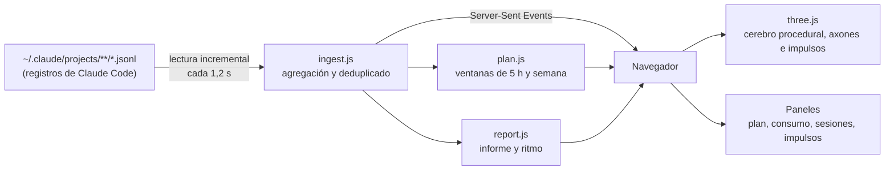

# Sinapsis

**El sistema nervioso de Claude Code, en tiempo real.**

[](https://github.com/albertoesgo/sinapsis/actions/workflows/ci.yml) [](LICENSE)  

**[▶ Pruébalo en el navegador](https://albertoesgo.github.io/sinapsis/)**: demo con datos sintéticos, sin instalar nada. En el móvil también funciona.

Un cerebro en 3D que se ilumina con la actividad real de tus sesiones de [Claude Code](https://claude.com/claude-code): cada petición, cada respuesta del modelo, cada herramienta, skill, subagente o conector que se usa viaja como un impulso por los axones del cerebro. Al mismo tiempo es un panel de control con el consumo de tokens y su coste equivalente por proyecto, por modelo y por agente.


> **In English.** Sinapsis is a real-time 3D brain that visualises what [Claude Code](https://claude.com/claude-code) is doing on your machine. It tails the session logs Claude Code already writes, turns every prompt, model response, tool call, skill and sub-agent into an impulse travelling between neurons, and doubles as a usage dashboard: tokens and API-equivalent cost per project and model, context size per session with alerts, a weekly report, and an estimate of how much of your Pro/Max 5-hour and weekly limits you have used, learned from the real limit cut-offs recorded in your history. Everything runs locally (Node + three.js, no frameworks, no build step); nothing leaves your computer. [Live demo](https://albertoesgo.github.io/sinapsis/) with synthetic data.

## Qué muestra

| Región del cerebro | Qué representa |
|---|---|
| **Corteza** | Tus proyectos, cada uno en la zona que corresponde a lo que más hace (ver abajo). Cada sesión es una neurona dentro de su región |
| **Tálamo** | Los modelos (Opus, Sonnet, Haiku, Fable…). Todo pensamiento pasa por aquí |
| **Corteza motora** | Las herramientas: Bash, Read, Edit, WebFetch… |
| **Cerebelo** | Las skills (memoria procedimental). Las que nunca se han usado se ven apagadas |
| **Giro cingulado** | Los tipos de subagente (general-purpose, Explore, Plan…) |
| **Lóbulo parietal** | Los conectores MCP (integran información que llega de fuera) |
| **Hipocampo** | La memoria persistente de cada proyecto |
| **Tronco encefálico** | Tus mensajes, que entran desde aquí |

### Dónde se coloca cada proyecto

Cada acción real de un proyecto se clasifica en una de cuatro funciones:

- **Planificar y razonar**: tokens de razonamiento (1 por cada 1.000), planes, preguntas y listas de tareas.
- **Ejecutar y construir**: comandos, lectura y edición de código, búsquedas en el repositorio.
- **Leer, investigar y escribir**: páginas web, búsquedas, documentos y textos (`.md`, `.pdf`, `.txt`…).
- **Trabajar con imágenes**: imágenes que le enseñas, capturas, ficheros de imagen y conectores de diseño.

Después se compara con la media de todos tus proyectos, y cada proyecto va a la zona del cerebro humano que hace aquello en lo que más destaca: corteza prefrontal (planificar), corteza premotora (ejecutar, junto a la corteza motora), lóbulo temporal **izquierdo** (lenguaje, que en la mayoría de personas está lateralizado a la izquierda) u occipital (visión, más hacia la derecha). Los proyectos de planificar y ejecutar, que son funciones de los dos hemisferios, se reparten a ambos lados. Al pasar el ratón por un proyecto se ve por qué está ahí, con sus porcentajes frente a la media.

Es una correspondencia con la anatomía real, pero no una medición del cerebro: dice a qué se dedica cada proyecto, no cómo «piensa» el modelo.

Y en los paneles:

- **Tu plan**: cuánto llevas de la ventana de 5 horas y del límite semanal de tu suscripción (Pro o Max), cuándo se reinicia cada uno y si, al ritmo actual, vas a llegar al límite antes. Avisa al pasar del 75 % y del 90 %. Usa, por orden de preferencia:
  1. **El dato real de Anthropic.** Claude Code le pasa a su línea de estado tus porcentajes reales en cada respuesta; la de Sinapsis (`npm run hooks:install`) los guarda y el plan parte de ahí, sumando lo que gastas después. Sin claves ni red.
  2. **Tu corrección.** Si usas Claude Code desde el móvil o la app (sin terminal, la línea de estado no se ejecuta), escribe el % que ves en *Ajustes → Uso* y Sinapsis recalibra el presupuesto.
  3. **Una estimación** con los cortes reales que Claude Code deja en el historial («You've hit your 5-hour limit · resets 10:50pm»): lo consumido justo antes de cada corte es tu presupuesto. No ve lo que gastas en la web o el móvil, así que puede quedarse corta.
  4. Opcional (`"usoReal": true` en `~/.sinapsis/config.json`): Sinapsis pregunta a Anthropic cada 5 minutos con la sesión que Claude Code guarda en el llavero de macOS, igual que `/usage`. Desactivado por defecto: es la única opción que sale a internet.
- **Ahora mismo**: lo único que conviene mirar, con un clic para ir a ello. Por ejemplo, la sesión que relee demasiado contexto o lo cerca que estás del límite.
- **Búsqueda (⌘K)**: salta a cualquier proyecto, sesión, skill, herramienta o acción.
- **Detalle de cada neurona**: cifras clave, gráfica de 30 días y el comando listo para copiar que retoma una sesión (`claude --resume …`) o abre el proyecto en la terminal.
- **Consumo**: coste equivalente de hoy, de 7 días, de 30 días y total, con barras diarias por proyecto, coste por modelo y qué parte del contexto se sirve desde la caché.
- **Proyectos**: estado (vivo, hoy, dormido), sesiones, tokens y qué agentes, skills y conectores trabajan en cada uno.
- **Anatomía del último pensamiento**: los tokens reales que el modelo tenía en contexto en la última respuesta (instrucciones, definiciones de herramientas, conversación), cuánto salió de la caché, cuánto razonó, cuánto generó y la cadena de pasos del turno.
- **Sesiones abiertas**: cuánto contexto relee cada sesión en cada paso, con un medidor verde, ámbar o rojo (100 k / 200 k) y la etiqueta encima de su neurona. Es el principal factor de consumo: por cada token que escribe, el modelo suele releer cientos.
- **Avisos**: cuando una sesión pasa de 200 k, 400 k o 600 k de contexto, llega una notificación de macOS y un aviso en la app (también en el móvil si la tienes abierta), sugiriendo `/compact` o una sesión nueva.
- **Informe semanal** (botón *Informe* y notificación los lunes a las 9:00): peticiones, valor por petición frente a la semana anterior, sesiones más pesadas, tendencia por proyecto y qué cambiar.
- **Valor por petición** de cada proyecto en los últimos 7 días, con su tendencia.
- **Impulsos**: los eventos en directo, agrupados por petición (tu mensaje y debajo los pasos que desencadenó), con filtros por tipo, herramientas repetidas fundidas en una línea y coste de cada petición.
- **EEG**: cuatro canales (entrada, razonamiento, acción y subagentes) con un pico por cada evento real de los últimos 3 minutos.
- **Inventario**: skills, agentes, herramientas, conectores y memoria, con lo que está en uso, lo usado hoy y lo que nunca se ha usado.
- **Reproducir 24 h**: vuelve a lanzar, acelerada, la actividad real del último día.

Atajos: <kbd>⌘K</kbd> o <kbd>/</kbd> buscar, <kbd>R</kbd> informe, <kbd>I</kbd> inventario, <kbd>H</kbd> centrar, <kbd>espacio</kbd> rotación, <kbd>L</kbd> etiquetas, <kbd>P</kbd> reproducir, <kbd>?</kbd> ayuda y <kbd>Esc</kbd> cerrar.


## Memoria común: un solo mapa de tus proyectos, que Claude usa solo

Lo que más tokens gasta en Claude Code no es lo que escribe, sino **buscar**: Glob, Grep y abrir ficheros enteros hasta dar con el sitio, y cada paso relee todo el contexto. Sinapsis aprende de tu historial real qué ficheros se leen y editan en cada petición, con qué órdenes se prueba cada proyecto, qué skills sirvieron y cuántos pasos se dedicaron a buscar antes de tocar nada.

**El atlas** (`server/atlas.js`) junta todo eso en un solo mapa. Si abres Claude en una carpeta que contiene varios proyectos (p. ej. `~/Proyectos`), cada fichero, orden y tarea vuelve a su proyecto real por su ruta: son las regiones del cerebro. Las conexiones entre regiones salen de lo que comparten de verdad: tareas que tocaron las dos, skills usadas en ambas y el mismo tipo de ficheros. Con el atlas, Claude recibe contexto sin pedirlo (`npm run hooks:install`):

- **Al abrir, reanudar o compactar una sesión** (hook `SessionStart`), un resumen de dónde está cada cosa: ficheros clave, temas, cómo se prueba y con qué se conecta cada proyecto. Unos 250 tokens, para no empezar de cero ni explorar a ciegas tras compactar.
- **Al escribir una tarea** (hook `UserPromptSubmit`), por qué ficheros empezar, la tarea parecida de la que sale la pista, la skill que se usó entonces y, si en otro proyecto resolviste algo parecido, dónde. **Solo cuando hay una pista clara**: si no, no añade nada y no gasta.

**¿Acierta? Se mide.** Sinapsis repite tu historial a ciegas: para cada tarea que acabó editando, busca con lo que se sabía antes y mira si el fichero editado estaba entre las 3 primeras pistas. En el historial con el que se desarrolló (127 tareas reales) acierta el **58 %**. Con el umbral de confianza da pista en el 35 % de las tareas y ahí acierta el 73 %, y cada acierto evita unos 4 pasos de búsqueda. Con los hooks puestos, la tarjeta **Memoria común** compara además en vivo las tareas con pista y sin ella: pasos de búsqueda, coste y acierto real.

También a mano:

- **En la ficha de cada proyecto**, «Dónde mirar»: sus ficheros clave y un buscador de por dónde empezar una tarea.
- **Desde la terminal** (o desde Claude):
  ```bash
  node scripts/donde.mjs --dir ~/mi-proyecto "el botón de pagar no responde en el móvil"
  node scripts/donde.mjs --dir ~/mi-proyecto --mapa      # ficheros clave, órdenes y tareas recientes
  ```
- **Skill para Claude Code** (`npm run skill:install`), para que Claude consulte el mapa cuando lo necesite. Hooks y skill en vez de un conector MCP: un MCP carga sus definiciones en cada paso de cada sesión, y estos solo gastan cuando aportan.
- **Vault de Obsidian** en `~/.sinapsis/vault`, regenerado cada 10 minutos: una nota por proyecto (también los que solo tocas desde la carpeta paraguas) con dónde mirar, las líneas de cada fichero, cómo se ejecuta, tareas recientes, temas y consejos para gastar menos («`js/admin.js`, 852 líneas, se ha leído 25 veces: pide solo la parte que toca»). Las notas de proyectos, skills, conectores y zonas están enlazadas por sus conexiones reales, y la vista de grafo dibuja el mismo cerebro. Obsidian es opcional: el vault es Markdown. Se desactiva con `"vault": false` en `~/.sinapsis/config.json`.

Es una pista estadística (palabras en común con peticiones anteriores, ponderadas por su rareza, más el nombre de los ficheros), no una lectura del código. Para quitar los hooks: `npm run hooks:remove`.

## Qué es real y qué no

Todos los datos salen de los registros que Claude Code ya guarda en `~/.claude/projects/**/*.jsonl` (uso de tokens de cada respuesta, llamadas a herramientas, subagentes, títulos de sesión…) y de lo que tienes instalado en `~/.claude/skills`, los plugins y las carpetas de memoria. **Nada sale de tu ordenador**: por defecto el servidor solo escucha en `127.0.0.1`, no hace peticiones a internet (salvo la consulta opcional del uso real, desactivada por defecto) y, si activas el acceso desde el móvil, solo responde en tu red local y con clave.

- Las neuronas y sus conexiones existen solo si el evento ocurrió de verdad. Su tamaño y su brillo dependen del uso real.
- Las chispas doradas que salen de un modelo al pensar representan sus *tokens de razonamiento* reales (una chispa por cada ~120).
- El reparto del contexto entre instrucciones de sistema y definiciones de herramientas es una estimación (≈3,6 caracteres por token) hecha a partir de la forma real de la petición que guarda Claude Code. Los totales de tokens sí son exactos.
- El coste se calcula a precios públicos de la API de Anthropic. Si usas una suscripción no pagas eso, pero sirve para comparar.
- **No muestra las activaciones internas del modelo.** Las neuronas artificiales, las capas y la atención de Claude se ejecutan en los servidores de Anthropic y no se exponen. La anatomía es una metáfora para organizar los datos; los datos son reales.

## Uso

Requiere Node 20 o posterior.

```bash
git clone https://github.com/albertoesgo/sinapsis.git
cd sinapsis
npm install
npm start            # http://localhost:7420
```

La primera vez lee todo el historial (unos segundos por cada pocos cientos de MB) y lo guarda en caché en `~/.sinapsis/state.json`. Después solo procesa lo nuevo, cada poco más de un segundo.

Sin datos propios, o para enseñarlo:

```bash
npm run demo         # actividad sintética
npm run check        # ESLint y pruebas
npm run build:demo   # demo estática en dist/ (la que se publica en GitHub Pages)
```

Opciones: `--port 7420`, `--claude-dir /ruta/a/.claude` (también respeta `CLAUDE_CONFIG_DIR`) y `--demo`.

### En el móvil

```bash
npm start -- --lan
```

Con `--lan`, Sinapsis también responde en tu wifi, protegido con una clave secreta que se genera sola (`~/.sinapsis/token`). En el ordenador, pulsa **Móvil** y escanea el código QR con el móvil, que tiene que estar en la misma red. En Safari, *Compartir → Añadir a pantalla de inicio* lo deja como una app. En el móvil, encima del cerebro tienes el plan y los avisos de un vistazo; las hojas se cierran deslizando hacia abajo. Sin la clave, el servidor devuelve un 401 y no muestra nada.

Si macOS pregunta si `node` puede aceptar conexiones entrantes, pulsa **Permitir**.

Por la wifi la conexión es `http`, y los navegadores solo activan el modo sin conexión y el botón de instalar con `https` o en `localhost`. En el iPhone, *Añadir a pantalla de inicio* funciona igualmente. En el propio ordenador (`localhost`) y en la [demo pública](https://albertoesgo.github.io/sinapsis/) es una PWA completa.

### Avisos en el móvil aunque la app esté cerrada (opcional)

Por defecto los avisos son locales: la notificación de macOS y la propia app. Para recibirlos en el móvil en cualquier momento, instala la app [ntfy](https://ntfy.sh), suscríbete a un tema con un nombre difícil de adivinar y añádelo a `~/.sinapsis/config.json`:

```json
{ "ntfy": "sinapsis-tu-tema-secreto" }
```

Así se envían al servidor de ntfy el título y el texto del aviso (nombre del proyecto y tamaño del contexto), nada más. Otras opciones: `"macNotify": false`, `"weeklyReport": false`, `"weeklyDay": 1` (lunes) y `"weeklyHour": 9`.

### Siempre encendido (macOS)

```bash
npm run service:install     # arranca al iniciar sesión y se reinicia si se cae
npm run service:uninstall
```

Crea un LaunchAgent (`~/Library/LaunchAgents/com.sinapsis.server.plist`) con el acceso por wifi activado (`SINAPSIS_LAN=0 npm run service:install` para dejarlo solo en local) y guarda el registro en `~/.sinapsis/sinapsis.log`.

## Cómo está hecho



### Decisiones técnicas

- **Sin frameworks ni compilación.** Node puro en el servidor (`http`, `fs`, `zlib`) y módulos ES en el navegador. Dos dependencias: three.js y un generador de QR.
- **Lectura incremental.** Cada fichero se lee desde el último byte procesado, así que un historial de cientos de MB se actualiza en milisegundos. La caché en disco evita releerlo al arrancar. Los mensajes se deduplican por id, porque Claude Code escribe una línea por cada bloque de una misma respuesta.
- **Tiempo real con SSE.** Cada evento nuevo llega al navegador por *Server-Sent Events*. Las instantáneas van comprimidas con gzip, y tras la primera se piden sin el historial de 24 h: de ~600 KB a ~12 KB.
- **Cerebro procedural.** Unas 110.000 partículas con ruido de Perlin forman hemisferios, surcos, cerebelo y tronco. Las ondas de activación se calculan en el *vertex shader*, el resplandor con *bloom* y los impulsos son curvas de Bézier con estela. Si el dispositivo no llega a 40 fps, la resolución baja sola.
- **Límites del plan con datos reales.** El porcentaje real llega por la línea de estado de Claude Code o por tu corrección; entre lecturas, se suma lo consumido en franjas de 10 minutos al presupuesto que implica la última lectura. Sin lecturas, el presupuesto se aprende de los cortes reales del historial.
- **Contexto que se gana su sitio.** Las pistas para Claude solo se dan por encima de un umbral de confianza calibrado repitiendo el historial a ciegas, y se miden en vivo (con pista frente a sin pista) en lugar de suponer que ahorran.
- **Seguridad.** Solo escucha en `127.0.0.1`. Con `--lan` exige una clave aleatoria (cookie `HttpOnly`). Los nombres de host se validan contra el *DNS rebinding*, y todo el texto se escapa antes de pintarlo.
- **PWA completa.** Se instala como app (iconos *maskable*, capturas y accesos directos a Informe, Plan, Buscar e Impulsos) y abre sin conexión con un *service worker* versionado. Cuando hay una versión nueva, avisa y se actualiza con una sola recarga. «Atrás» (botón, gesto de Android o Esc) cierra solo la pantalla de arriba y vuelve a la anterior, sin salir de la app.
- **Responsive y táctil.** Paneles en escritorio; hojas inferiores con gestos (deslizar para cerrar o ampliar, doble toque para centrar) en móvil y tableta; hojas laterales con el móvil en horizontal; alturas en `dvh` para que Safari no corte nada.
- **Pruebas e integración continua.** `npm run lint` (ESLint) y `npm test` (con `node:test`, sin dependencias). Las pruebas cubren precios, lectura de registros, cortes y lecturas reales del plan, el informe, el mapa y el atlas. GitHub Actions las ejecuta en Node 20, 22 y 24 y publica la demo en GitHub Pages.

### Ficheros

- `server/where.js` responde «dónde mirar» (TF-IDF sobre peticiones pasadas). `server/atlas.js` une todos los proyectos en un mapa con regiones y conexiones, genera el contexto de los hooks (`scripts/hook.mjs`) y mide el acierto. `server/vault.js` genera el vault de Obsidian y `scripts/donde.mjs` lo lleva a la terminal.
- `server/usage.js` guarda las lecturas reales del plan (de `scripts/statusline.mjs`, de tu corrección o de la consulta opcional) y `server/plan.js` las combina con la estimación.
- `server/plan.js` reconstruye las ventanas de 5 horas y la semana a partir del consumo en franjas de 10 minutos y de los cortes reales.
- `server/ingest.js` lee los `.jsonl` de forma incremental (por desplazamiento de bytes), descarta duplicados por id de mensaje y agrega el uso de tokens, el coste, las herramientas, las skills, los subagentes, los conectores y la memoria. Envía cada evento al navegador por *Server-Sent Events*.
- `server/inventory.js` hace inventario de lo instalado, se use o no.
- `public/js/brain.js` genera la anatomía de forma procedural: dos hemisferios con circunvoluciones hechas con ruido de Perlin, surco central, cisura de Silvio, cerebelo con folias y tronco encefálico. Son unas 110.000 partículas con ondas de activación en el *shader*.
- `public/js/neurons.js` coloca cada nodo real en su región anatómica, con somas, dendritas, axones curvos y la animación de los impulsos.
- `public/js/hud.js` reúne el estado de la interfaz; cada área vive en su módulo de `public/js/hud/` (plan, paneles, impulsos, búsqueda, informe, detalle, gestos y formato).
- `public/js/static.js` hace de servidor en la demo pública: desplaza las fechas de los datos grabados y reproduce la actividad en bucle.

Depende de [three.js](https://threejs.org) y de [qrcode](https://github.com/soldair/node-qrcode).

## Licencia

MIT
