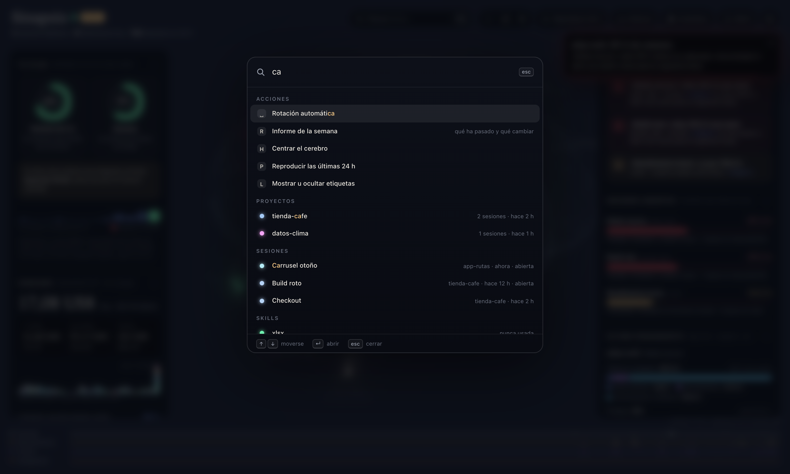

# Sinapsis

**El sistema nervioso de Claude Code, en tiempo real.**

Un cerebro en 3D que se ilumina con la actividad real de tus sesiones de [Claude Code](https://claude.com/claude-code): cada petición, cada respuesta del modelo, cada herramienta, skill, subagente o conector que se usa viaja como un impulso por los axones del cerebro. Al mismo tiempo es un panel de control con el consumo de tokens y su coste equivalente por proyecto, por modelo y por agente.


## Qué muestra

| Región del cerebro | Qué representa |
|---|---|
| **Corteza** | Tus proyectos, cada uno en la zona que corresponde a lo que más hace (ver abajo). Cada sesión es una neurona dentro de su región |
| **Tálamo** | Los modelos (Opus, Sonnet, Haiku, Fable…). Todo pensamiento pasa por aquí |
| **Corteza motora** | Las herramientas: Bash, Read, Edit, WebFetch… |
| **Cerebelo** | Las skills (memoria procedimental). Las que nunca se han usado se ven apagadas |
| **Giro cingulado** | Los tipos de subagente (general-purpose, Explore, Plan…) |
| **Lóbulo parietal** | Los conectores MCP (integran información que llega de fuera) |
| **Hipocampo** | La memoria persistente de cada proyecto |
| **Tronco encefálico** | Tus mensajes, que entran desde aquí |

### Dónde se coloca cada proyecto

Cada acción real de un proyecto se clasifica en una de cuatro funciones:

- **Planificar y razonar**: tokens de razonamiento (1 por cada 1.000), planes, preguntas y listas de tareas.
- **Ejecutar y construir**: comandos, lectura y edición de código, búsquedas en el repositorio.
- **Leer, investigar y escribir**: páginas web, búsquedas, documentos y textos (`.md`, `.pdf`, `.txt`…).
- **Trabajar con imágenes**: imágenes que le enseñas, capturas, ficheros de imagen y conectores de diseño.

Después se compara con la media de todos tus proyectos, y cada proyecto va a la zona del cerebro humano que hace aquello en lo que más destaca: corteza prefrontal (planificar), corteza premotora (ejecutar, junto a la corteza motora), lóbulo temporal **izquierdo** (lenguaje, que en la mayoría de personas está lateralizado a la izquierda) u occipital (visión, más hacia la derecha). Los proyectos de planificar y ejecutar, que son funciones de los dos hemisferios, se reparten a ambos lados. Al pasar el ratón por un proyecto se ve por qué está ahí, con sus porcentajes frente a la media.

Es una correspondencia con la anatomía real, pero no una medición del cerebro: dice a qué se dedica cada proyecto, no cómo «piensa» el modelo.

Y en los paneles:

- **Tu plan**: cuánto llevas de la ventana de 5 horas y del límite semanal de tu suscripción (Pro o Max), cuándo se reinicia cada uno y si, al ritmo actual, vas a llegar al límite antes. Claude Code deja escrito en el historial cada corte («You've hit your 5-hour limit · resets 10:50pm»). Sinapsis mide lo que habías consumido justo antes de cada corte y lo usa como tu presupuesto. Es una estimación: si también usas Claude en la web o en el móvil, eso cuenta y aquí no se ve. Avisa al pasar del 75 % y del 90 %.
- **Ahora mismo**: lo único que conviene mirar, con un clic para ir a ello. Por ejemplo, la sesión que relee demasiado contexto o lo cerca que estás del límite.
- **Búsqueda (⌘K)**: salta a cualquier proyecto, sesión, skill, herramienta o acción.
- **Detalle de cada neurona**: cifras clave, gráfica de 30 días y el comando listo para copiar que retoma una sesión (`claude --resume …`) o abre el proyecto en la terminal.
- **Consumo**: coste equivalente de hoy, de 7 días, de 30 días y total, con barras diarias por proyecto, coste por modelo y qué parte del contexto se sirve desde la caché.
- **Proyectos**: estado (vivo, hoy, dormido), sesiones, tokens y qué agentes, skills y conectores trabajan en cada uno.
- **Anatomía del último pensamiento**: los tokens reales que el modelo tenía en contexto en la última respuesta (instrucciones, definiciones de herramientas, conversación), cuánto salió de la caché, cuánto razonó, cuánto generó y la cadena de pasos del turno.
- **Sesiones abiertas**: cuánto contexto relee cada sesión en cada paso, con un medidor verde, ámbar o rojo (100 k / 200 k) y la etiqueta encima de su neurona. Es el principal factor de consumo: por cada token que escribe, el modelo suele releer cientos.
- **Avisos**: cuando una sesión pasa de 200 k, 400 k o 600 k de contexto, llega una notificación de macOS y un aviso en la app (también en el móvil si la tienes abierta), sugiriendo `/compact` o una sesión nueva.
- **Informe semanal** (botón *Informe* y notificación los lunes a las 9:00): peticiones, valor por petición frente a la semana anterior, sesiones más pesadas, tendencia por proyecto y qué cambiar.
- **Valor por petición** de cada proyecto en los últimos 7 días, con su tendencia.
- **Impulsos**: la secuencia de eventos en directo.
- **EEG**: cuatro canales (entrada, razonamiento, acción y subagentes) con un pico por cada evento real de los últimos 3 minutos.
- **Inventario**: skills, agentes, herramientas, conectores y memoria, con lo que está en uso, lo usado hoy y lo que nunca se ha usado.
- **Reproducir 24 h**: vuelve a lanzar, acelerada, la actividad real del último día.

Atajos: <kbd>⌘K</kbd> o <kbd>/</kbd> buscar, <kbd>R</kbd> informe, <kbd>I</kbd> inventario, <kbd>H</kbd> centrar, <kbd>espacio</kbd> rotación, <kbd>L</kbd> etiquetas, <kbd>P</kbd> reproducir, <kbd>?</kbd> ayuda y <kbd>Esc</kbd> cerrar.



## Qué es real y qué no

Todos los datos salen de los registros que Claude Code ya guarda en `~/.claude/projects/**/*.jsonl` (uso de tokens de cada respuesta, llamadas a herramientas, subagentes, títulos de sesión…) y de lo que tienes instalado en `~/.claude/skills`, los plugins y las carpetas de memoria. **Nada sale de tu ordenador**: por defecto el servidor solo escucha en `127.0.0.1`, nunca hace peticiones a internet y, si activas el acceso desde el móvil, solo responde en tu red local y con clave.

- Las neuronas y sus conexiones existen solo si el evento ocurrió de verdad. Su tamaño y su brillo dependen del uso real.
- Las chispas doradas que salen de un modelo al pensar representan sus *tokens de razonamiento* reales (una chispa por cada ~120).
- El reparto del contexto entre instrucciones de sistema y definiciones de herramientas es una estimación (≈3,6 caracteres por token) hecha a partir de la forma real de la petición que guarda Claude Code. Los totales de tokens sí son exactos.
- El coste se calcula a precios públicos de la API de Anthropic. Si usas una suscripción no pagas eso, pero sirve para comparar.
- **No muestra las activaciones internas del modelo.** Las neuronas artificiales, las capas y la atención de Claude se ejecutan en los servidores de Anthropic y no se exponen. La anatomía es una metáfora para organizar los datos; los datos son reales.

## Uso

Requiere Node 18 o posterior.

```bash
git clone https://github.com/albertoesgo/sinapsis.git
cd sinapsis
npm install
npm start            # http://localhost:7420
```

La primera vez lee todo el historial (unos segundos por cada pocos cientos de MB) y lo guarda en caché en `~/.sinapsis/state.json`. Después solo procesa lo nuevo, cada poco más de un segundo.

Sin datos propios, o para enseñarlo:

```bash
npm run demo         # actividad sintética
```

Opciones: `--port 7420`, `--claude-dir /ruta/a/.claude` (también respeta `CLAUDE_CONFIG_DIR`) y `--demo`.

### En el móvil

```bash
npm start -- --lan
```

Con `--lan`, Sinapsis también responde en tu wifi, protegido con una clave secreta que se genera sola (`~/.sinapsis/token`). En el ordenador, pulsa **Móvil** y escanea el código QR con el móvil, que tiene que estar en la misma red. En Safari, *Compartir → Añadir a pantalla de inicio* lo deja como una app. Sin la clave, el servidor devuelve un 401 y no muestra nada.

Si macOS pregunta si `node` puede aceptar conexiones entrantes, pulsa **Permitir**.

### Avisos en el móvil aunque la app esté cerrada (opcional)

Por defecto los avisos son locales: la notificación de macOS y la propia app. Para recibirlos en el móvil en cualquier momento, instala la app [ntfy](https://ntfy.sh), suscríbete a un tema con un nombre difícil de adivinar y añádelo a `~/.sinapsis/config.json`:

```json
{ "ntfy": "sinapsis-tu-tema-secreto" }
```

Así se envían al servidor de ntfy el título y el texto del aviso (nombre del proyecto y tamaño del contexto), nada más. Otras opciones: `"macNotify": false`, `"weeklyReport": false`, `"weeklyDay": 1` (lunes) y `"weeklyHour": 9`.

### Siempre encendido (macOS)

```bash
npm run service:install     # arranca al iniciar sesión y se reinicia si se cae
npm run service:uninstall
```

Crea un LaunchAgent (`~/Library/LaunchAgents/com.sinapsis.server.plist`) con el acceso por wifi activado (`SINAPSIS_LAN=0 npm run service:install` para dejarlo solo en local) y guarda el registro en `~/.sinapsis/sinapsis.log`.

## Cómo está hecho

- `server/plan.js` reconstruye las ventanas de 5 horas y la semana a partir del consumo en franjas de 10 minutos y de los cortes reales.
- `server/ingest.js` lee los `.jsonl` de forma incremental (por desplazamiento de bytes), descarta duplicados por id de mensaje y agrega el uso de tokens, el coste, las herramientas, las skills, los subagentes, los conectores y la memoria. Envía cada evento al navegador por *Server-Sent Events*.
- `server/inventory.js` hace inventario de lo instalado, se use o no.
- `public/js/brain.js` genera la anatomía de forma procedural: dos hemisferios con circunvoluciones hechas con ruido de Perlin, surco central, cisura de Silvio, cerebelo con folias y tronco encefálico. Son unas 110.000 partículas con ondas de activación en el *shader*.
- `public/js/neurons.js` coloca cada nodo real en su región anatómica, con somas, dendritas, axones curvos y la animación de los impulsos.
- `public/js/hud.js` se encarga de los paneles, el EEG, la anatomía del pensamiento y el inventario.

Depende de [three.js](https://threejs.org) y de [qrcode](https://github.com/soldair/node-qrcode).

## Licencia

MIT
