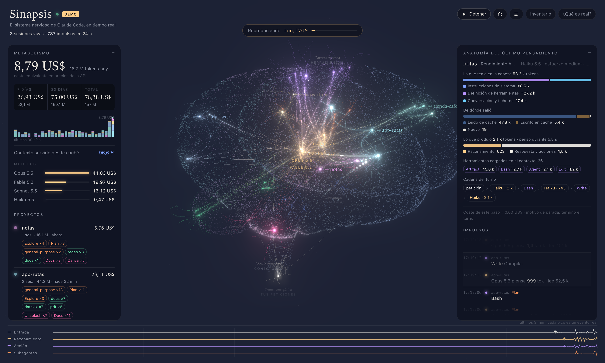

# Sinapsis

**El sistema nervioso de Claude Code, en tiempo real.**

Un cerebro en 3D que se ilumina con la actividad real de tus sesiones de [Claude Code](https://claude.com/claude-code): cada petición, cada respuesta del modelo, cada herramienta, skill, subagente o conector que se usa viaja como un impulso por los axones del cerebro. Al mismo tiempo es un panel de control con el consumo de tokens y su coste equivalente por proyecto, por modelo y por agente.



## Qué muestra

| Región del cerebro | Qué representa |
|---|---|
| **Corteza** | Tus proyectos. Cada sesión es una neurona dentro de su región |
| **Tálamo** | Los modelos (Opus, Sonnet, Haiku, Fable…). Todo pensamiento pasa por aquí |
| **Corteza motora** | Las herramientas: Bash, Read, Edit, WebFetch… |
| **Cerebelo** | Las skills (memoria procedimental). Las que nunca se han usado se ven apagadas |
| **Giro cingulado** | Los tipos de subagente (general-purpose, Explore, Plan…) |
| **Lóbulo temporal** | Los conectores MCP (los "sentidos" hacia fuera) |
| **Hipocampo** | La memoria persistente de cada proyecto |
| **Tronco encefálico** | Tus mensajes, que entran desde aquí |

Y en los paneles:

- **Metabolismo**: coste equivalente de hoy, de 7 días, de 30 días y total, con barras diarias por proyecto, coste por modelo y qué parte del contexto se sirve desde la caché.
- **Proyectos**: estado (vivo, hoy, dormido), sesiones, tokens y qué agentes, skills y conectores trabajan en cada uno.
- **Anatomía del último pensamiento**: los tokens reales que el modelo tenía en contexto en la última respuesta (instrucciones, definiciones de herramientas, conversación), cuánto salió de la caché, cuánto razonó, cuánto generó y la cadena de pasos del turno.
- **Impulsos**: la secuencia de eventos en directo.
- **EEG**: cuatro canales (entrada, razonamiento, acción y subagentes) con un pico por cada evento real de los últimos 3 minutos.
- **Inventario**: skills, agentes, herramientas, conectores y memoria, con lo que está en uso, lo usado hoy y lo que nunca se ha usado.
- **Reproducir 24 h**: vuelve a lanzar, acelerada, la actividad real del último día.

## Qué es real y qué no

Todos los datos salen de los registros que Claude Code ya guarda en `~/.claude/projects/**/*.jsonl` (uso de tokens de cada respuesta, llamadas a herramientas, subagentes, títulos de sesión…) y de lo que tienes instalado en `~/.claude/skills`, los plugins y las carpetas de memoria. **Nada sale de tu ordenador**: el servidor solo escucha en `127.0.0.1` y no hace peticiones a internet.

- Las neuronas y sus conexiones existen solo si el evento ocurrió de verdad. Su tamaño y su brillo dependen del uso real.
- Las chispas doradas que salen de un modelo al pensar representan sus *tokens de razonamiento* reales (una chispa por cada ~120).
- El reparto del contexto entre instrucciones de sistema y definiciones de herramientas es una estimación (≈3,6 caracteres por token) hecha a partir de la forma real de la petición que guarda Claude Code. Los totales de tokens sí son exactos.
- El coste se calcula a precios públicos de la API de Anthropic. Si usas una suscripción no pagas eso, pero sirve para comparar.
- **No muestra las activaciones internas del modelo.** Las neuronas artificiales, las capas y la atención de Claude se ejecutan en los servidores de Anthropic y no se exponen. La anatomía es una metáfora para organizar los datos; los datos son reales.

## Uso

Requiere Node 18 o posterior.

```bash
git clone https://github.com/albertoesgo/sinapsis.git
cd sinapsis
npm install
npm start            # http://localhost:7420
```

La primera vez lee todo el historial (unos segundos por cada pocos cientos de MB) y lo guarda en caché en `~/.sinapsis/state.json`. Después solo procesa lo nuevo, cada poco más de un segundo.

Sin datos propios, o para enseñarlo:

```bash
npm run demo         # actividad sintética
```

Opciones: `--port 7420`, `--claude-dir /ruta/a/.claude` (también respeta `CLAUDE_CONFIG_DIR`) y `--demo`.

### Siempre encendido (macOS)

```bash
npm run service:install     # arranca al iniciar sesión y se reinicia si se cae
npm run service:uninstall
```

Crea un LaunchAgent (`~/Library/LaunchAgents/com.sinapsis.server.plist`) y guarda el registro en `~/.sinapsis/sinapsis.log`.

## Cómo está hecho

- `server/ingest.js` lee los `.jsonl` de forma incremental (por desplazamiento de bytes), descarta duplicados por id de mensaje y agrega el uso de tokens, el coste, las herramientas, las skills, los subagentes, los conectores y la memoria. Envía cada evento al navegador por *Server-Sent Events*.
- `server/inventory.js` hace inventario de lo instalado, se use o no.
- `public/js/brain.js` genera la anatomía de forma procedural: dos hemisferios con circunvoluciones hechas con ruido de Perlin, surco central, cisura de Silvio, cerebelo con folias y tronco encefálico. Son unas 110.000 partículas con ondas de activación en el *shader*.
- `public/js/neurons.js` coloca cada nodo real en su región anatómica, con somas, dendritas, axones curvos y la animación de los impulsos.
- `public/js/hud.js` se encarga de los paneles, el EEG, la anatomía del pensamiento y el inventario.

Solo depende de [three.js](https://threejs.org).

## Licencia

MIT
